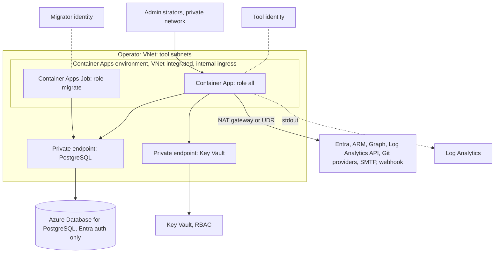
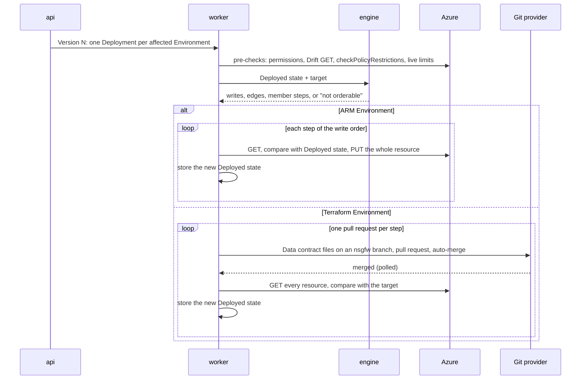

# Architecture proposal

Status: draft from [Prototype: Architecture proposal][t26], 2026-11-10. It puts the decisions of the closed tickets and the ADRs into one picture. It decides only what the review round left to it: the tool's own subnets are not onboardable, and the minimum azurerm version is 3.39.0. Every other hole is listed under [Gaps for the map](#gaps-for-the-map) with the ticket that now holds it. On 2026-11-10 [Grilling: Operations: restore, exit, upgrades and exposure][t29] decided gaps 2 to 7, 11 and 12. The design-package review covers this document. Terms follow [GLOSSARY.md](../../GLOSSARY.md).

## What nsgfw is

nsgfw is a web tool that runs Azure NSGs like a firewall console. Administrators edit one central Rule base of Zones, Objects and ordered Rules. The Translation engine turns it into Managed NSGs, NSG rules, Managed ASGs and subnet associations. A Commit creates a Version and one Deployment per affected Environment. An ARM Environment gets direct writes. A Terraform Environment gets pull requests with a Data contract.

The tool is one container image with a PostgreSQL database. It runs in Azure Container Apps or on-premises, for example with Docker Compose ([Grilling: Tech stack and repository architecture][t10]).

## Components

```mermaid
flowchart LR
  browser["Browser: apps/web"] -->|"session cookie"| api
  clients["Scripts, CI, SIEM collector"] -->|"bearer token"| api
  subgraph image["One image, role flag"]
    api["api: Fastify REST, OpenAPI, serves the web build"]
    worker["worker: jobs"]
    migrate["migrate: one-shot, schema owner"]
  end
  api --> db[("PostgreSQL: domain tables, sessions, audit log, pg-boss queue")]
  worker --> db
  migrate --> db
  api --> engine["packages/engine"]
  worker --> engine
  engine --> model["packages/model"]
  api --> azure["packages/azure"]
  worker --> azure
  azure --> arm["ARM, Resource Graph, Policy Insights, Log Analytics query API"]
  worker --> git["Git providers: GitHub App, Azure DevOps"]
  api --> graph["Microsoft Graph"]
  api --> entra["Entra ID sign-in"]
  image --> kv["Key Vault"]
  image -->|"audit JSON lines on stdout"| logs["Log Analytics or a log shipper"]
```

### Repository

A pnpm workspace with TypeScript project references, ESM only, `strict`, MIT licence and only permissive open-source dependencies ([ADR 0002](../adr/0002-mit-licence-and-open-source-dependencies-only.md)).

| Path | Holds |
|---|---|
| `apps/server` | Fastify 5 API and worker, serves the web build |
| `apps/web` | Vite and React 19 SPA, Fluent UI React v9, AG Grid Community for the Rule base table, react-intl for English and German, TanStack Query |
| `packages/model` | Rule base types, Zod 4 schemas, validation with error codes and parameters, the evaluation function that the packet tracer will reuse |
| `packages/engine` | the Translation engine, pure, no I/O |
| `packages/azure` | the only code that calls Azure (`@azure/identity`, `@azure/arm-network`, `@azure/arm-resourcegraph`, raw requests through the same pipeline where the SDK lacks an option) |
| `infra/` | Terraform for the tool itself: the `instance` and `environment-access` modules |

Where the database layer, the Data contract generator and the Git provider code live is not decided yet ([gap 8](#gaps-for-the-map)).

### Process roles

The image takes a role flag ([Grilling: Tech stack and repository architecture][t10], amended by [ADR 0015](../adr/0015-separate-migrate-step-protects-audit-log.md)):

- `all` runs `api` and `worker` in one process. It is the default.
- `api` serves the REST API, the web build and the sign-in flow.
- `worker` runs the jobs below.
- `migrate` applies the Kysely migrations as schema owner and exits. The app refuses to start when the schema is older than it expects. Migrations only add, so the previous revision keeps working during an upgrade.

To scale later, `api` and `worker` run as separate containers from the same image.

### Job queue and jobs

Jobs go through a durable queue in PostgreSQL (pg-boss behind the tool's own job-queue interface, no Redis). The progress of each Deployment step lives in domain tables, not in the queue, so the library can be swapped.

| Job | Runs | Decided in |
|---|---|---|
| Deployment | after a Commit, at a scheduled time, on Retry, as an Emergency Commit, as a catch-up after a re-home. Holds a lease with a heartbeat; another worker takes over when it expires | [Grilling: Deployment execution and failure handling][t16] |
| Terraform stage watch | polls the pull request state, then reads Azure until it matches the target or the apply timeout ends (default 2 hours) | [Grilling: Terraform mode workflow][t17] |
| Drift poll | every 5 minutes per Environment (a setting): Resource Graph `resourcechanges` for watched resources, each hit confirmed with a GET. Also refreshes Security layers and compares Data contract files on the base branch | [Grilling: Import and drift handling][t18], [Grilling: Policy and security-layer visibility][t21] |
| Full reconcile | every 24 hours, all tool resources; also the Recovery check, which runs at startup too ([Backup and recovery](#backup-and-recovery)) | [Grilling: Import and drift handling][t18], [Grilling: Operations: restore, exit, upgrades and exposure][t29] |
| Permission check | at Environment onboarding, at Zone onboarding, daily, before the first write of every Deployment | [ADR 0014](../adr/0014-operator-grants-azure-roles-tool-verifies.md) |
| Rule expiry | notice to the owner 14 days ahead; at expiry the tool's own Commit disables the allow Rule, also while a Re-translation is open ([Engine upgrades](#engine-upgrades)) | [Grilling: Change sets, concurrency and approval][t15] |
| Prepared Change sets | regenerated when Azure changes: Coverage changes, stale member IPs, External ASG object members, expired deny Rules | [Grilling: Change sets, concurrency and approval][t15] |
| Member IP adoption | removes a deleted ASG member from its object, deny Rules included, and adopts a changed member IP, on IP-fallback NSGs and without Approval, also while a Re-translation is open | [Grilling: Review round on placement, egress posture and MVP shape][t27], [Prototype: Translation engine worked examples][t22] |
| Lost-update check | after membership writes, Resource Graph `resourcechanges` for another writer between GET and PUT, unless `If-Match` works | [Grilling: Deployment execution and failure handling][t16] |
| Audit chain verify | reports a broken hash chain; accepts a fork only at a recovery entry | [Grilling: Access, roles and audit][t19], [ADR 0019](../adr/0019-instance-identity-in-the-database-and-recovery-mode.md) |
| Flow data | aggregated, cached queries against the Environment's workspace for the Flow view and hits | [Research: Traffic Analytics access for the Flow view and hits][t28] |
| Certificate expiry | warns 30 days ahead in the admin view and the health endpoint | [Grilling: Hosting, identity and least-privilege role][t20] |

Group memberships are resolved through Graph at sign-in and every 15 minutes per session. That happens in `api`, on the request path. Key Vault secrets are cached in memory and refreshed every 30 minutes and after an authentication failure.

### The Translation engine boundary

`packages/engine` is pure. The same inputs give the same outputs, and it does no I/O. It runs wherever the server needs it: for the Preview, at validation, and when a Deployment plans its writes. The algorithm, step by step and with worked examples, is in [Translation engine](translation-engine.md).

In:

- the Rule base of one Version: Rules, Objects, Zones with their Egress posture, Extra prefixes and Inherited defaults, the Internal address space, VNet bindings;
- an Azure inventory snapshot: VNets, peerings, subnets and prefixes, ASG members and their IPs, existing NSGs at Import;
- the NSG rule names and priorities of the previous Version, so priorities stay stable ([ADR 0005](../adr/0005-stable-nsg-rule-identity.md));
- the Deployed state of every resource the Deployment touches, for the write order ([ADR 0018](../adr/0018-write-order-from-dominance-gaps.md));
- the versioned limits data file.

Out:

- the target content of every Managed NSG and Retired NSG, with names and priorities, every NSG rule belonging to exactly one Rule;
- Managed ASGs, their memberships and the subnet associations;
- validation errors and warnings as codes with parameters, limit counts, Affected Zones and the Preview diff;
- the write order: dependency edges, Crossing-flow edges and the three ASG member steps, or "not orderable" with the flows that cause it.

Every Version stores the engine version that produced its NSG rules ([Grilling: Review round on placement, egress posture and MVP shape][t27], point 20). How the engine finds Crossing flows at the design target (10,000 Rules, 20,000 Zones) is still open. Only pairs of Zones whose NSGs both change need a look ([ADR 0018](../adr/0018-write-order-from-dominance-gaps.md)).

## Identities and permissions

```mermaid
flowchart LR
  user["Person"] -->|"auth code + PKCE"| app["App registration: sign-in, API scope, InstanceAdmin app role, Graph application permissions"]
  app -->|"Graph"| graph["Microsoft Graph"]
  tool["Tool identity: Azure roles only"] -->|"nsgfw Reader, Writer, ASG Writer"| azure["Environments"]
  tool -->|"federated credential of"| app
  migrator["Migrator identity"] -->|"schema owner"| pg[("PostgreSQL")]
  tool -->|"runtime role"| pg
```

### Principals

| Principal | Azure | On-premises | Holds |
|---|---|---|---|
| App registration | federated credential = the Tool identity, no stored secret | its service principal is also the Tool identity, one PEM certificate | sign-in, API audience and delegated scope with the Azure CLI pre-authorized, the `InstanceAdmin` app role, Graph application permissions |
| Tool identity | user-assigned managed identity | the app registration's service principal | Azure roles only; runtime database role in Azure; Key Vault Secrets User |
| Migrator | second user-assigned managed identity, only on the migrate job | owner password as a file in the migrate container | database schema owner |
| GitHub App | private key in Key Vault | same | contents write, pull requests write, checks read, metadata read |

Fallback in Azure if MSAL Node cannot redeem an authorization code with the managed identity as federated credential: a certificate with a non-exportable key in Key Vault, signed through Key Vault Crypto User ([ADR 0013](../adr/0013-backend-sign-in-and-separate-directory-and-azure-principals.md)). [Task: Empirical checks of undocumented Azure behaviour][t24] tests this.

### Sign-in and API access

The server runs a backend-for-frontend with MSAL Node: authorization code flow with PKCE as a confidential client, a server-side session in PostgreSQL behind an httpOnly cookie, no tokens in the browser and no user access tokens kept on the server. Sessions last 8 hours, or 60 minutes idle. Approval, Emergency Commit and changes to Role assignments need a sign-in at most 15 minutes old (OIDC `max_age`).

The API also accepts client-credential tokens of service principals and managed identities and delegated user tokens through the one exposed scope. Rights come from the same Roles. Step-up actions stay UI-only. "Assignment required" stays off on the enterprise application; the tool's Role assignments decide, and a denied action is audited ([Grilling: Hosting, identity and least-privilege role][t20], [Grilling: Access, roles and audit][t19]).

### Azure roles

The operator grants, the tool verifies. The tool never holds `Microsoft.Authorization/roleAssignments/write`. One set of role definitions sits at one management group, by default the tenant root; in the small profile it can sit on a subscription. Every action is explicit, and the same list drives the permission check ([ADR 0014](../adr/0014-operator-grants-azure-roles-tool-verifies.md) as amended by [Grilling: Review round on placement, egress posture and MVP shape][t27]).

**`nsgfw Reader`**, in every Environment at the Environment's scope:

| Action | Why |
|---|---|
| `Microsoft.Management/managementGroups/read` | Environments defined by a management group; subscription moves |
| `Microsoft.Resources/subscriptions/read` | list the subscriptions of an Environment |
| `Microsoft.Resources/subscriptions/resourceGroups/read` | an NSG write needs read on the resource group; onboarding checks the target resource group |
| `Microsoft.ResourceGraph/resources/read` | discovery through Resource Graph (whether it is required is open) |
| `Microsoft.ResourceGraph/resourceChanges/read` | Drift poll, lost-update check |
| `Microsoft.Authorization/permissions/read` | the permission check |
| `Microsoft.Network/virtualNetworks/read` | VNets, prefixes, peerings, DNS servers, Coverage |
| `Microsoft.Network/virtualNetworks/subnets/read` | subnets, prefixes, associations, special subnets |
| `Microsoft.Network/networkSecurityGroups/read` | Managed and Unmanaged NSGs, NIC-level NSGs |
| `Microsoft.Network/networkSecurityGroups/securityRules/read` | Import, Drift, Deployed state comparison |
| `Microsoft.Network/networkSecurityGroups/defaultSecurityRules/read` | Azure default rules shown read-only |
| `Microsoft.Network/applicationSecurityGroups/read` | Managed ASGs, Unmanaged ASGs of External ASG objects |
| `Microsoft.Network/networkInterfaces/read` | ASG members, NIC-level NSGs, member IPs, IP forwarding |
| `Microsoft.Network/privateEndpoints/read` | ASG members that are private endpoints |
| `Microsoft.Compute/virtualMachineScaleSets/read` | scale sets in Unmanaged ASGs |
| `Microsoft.Compute/virtualMachineScaleSets/virtualMachines/networkInterfaces/read` | scale-set and AKS node interfaces |
| `Microsoft.Network/locations/usages/read` | live limit counts per subscription and region |
| `Microsoft.Network/locations/serviceTags/read` | service-tag picker |
| `Microsoft.Network/locations/serviceTagDetails/read` | service-tag prefixes for the Security layer overlap warnings and the later packet tracer. Service tags have no Coverage, so the reason "for Coverage" in [Grilling: Hosting, identity and least-privilege role][t20] is corrected here |
| `Microsoft.Network/locations/operations/read` | long-running operation status |
| `Microsoft.Network/locations/operationResults/read` | long-running operation results |
| `Microsoft.Network/virtualNetworks/listNetworkManagerEffectiveSecurityAdminRules/read` | AVNM security admin rules shown read-only |
| `Microsoft.PolicyInsights/checkPolicyRestrictions/read` | policy pre-check |
| `Microsoft.Authorization/policyAssignments/read` | assignment names, messages, `enforcementMode`, `notScopes` |
| `Microsoft.Authorization/policyDefinitions/read` | definition names |
| `Microsoft.Authorization/policySetDefinitions/read` | initiative names |
| `Microsoft.Authorization/policyExemptions/read` | exemptions that cover a finding |
| `Microsoft.Network/networkWatchers/read` | find flow logs |
| `Microsoft.Network/networkWatchers/flowLogs/read` | flow log targets, filters and workspace |
| `Microsoft.OperationalInsights/workspaces/read` | the Environment's flow-data workspace |
| `Microsoft.OperationalInsights/workspaces/query/read` | query the workspace |
| data action `Microsoft.OperationalInsights/workspaces/tables/data/read`, limited to `NTANetAnalytics` by a condition on every Reader assignment | read `NTANetAnalytics`. The legacy table action `workspaces/query/NTANetAnalytics/read` stays out: Microsoft calls it no longer recommended, and `DataActionsOnly` workspaces ignore it ([ADR 0014](../adr/0014-operator-grants-azure-roles-tool-verifies.md) as amended by [Grilling: Operations: restore, exit, upgrades and exposure][t29]) |

The first 23 rows come from [Grilling: Hosting, identity and least-privilege role][t20], the four policy reads from [Grilling: Policy and security-layer visibility][t21], the flow-data reads from [Research: Traffic Analytics access for the Flow view and hits][t28].

**`nsgfw Writer`**, in ARM Environments only, at the Environment's scope or narrower:

| Action | Why |
|---|---|
| `Microsoft.Network/networkSecurityGroups/write` | whole-NSG PUT with marker tags and `flushConnection` |
| `Microsoft.Network/networkSecurityGroups/delete` | delete NSGs the tool created when their subnet is gone |
| `Microsoft.Network/networkSecurityGroups/join/action` | associate a Managed NSG with a subnet |
| `Microsoft.Network/virtualNetworks/subnets/write` | set or swap the subnet's NSG association. The tool changes nothing else on a subnet ([Grilling: Zone onboarding and NSG lifecycle][t11], point 10; corrects the reason in [Grilling: Hosting, identity and least-privilege role][t20]) |
| `Microsoft.Network/applicationSecurityGroups/joinNetworkSecurityRule/action` | NSG rules that reference a Managed ASG or the ASG of an External ASG object |

**`nsgfw ASG Writer`**, optional, only where ASG objects with tool-written membership are used:

| Action | Why |
|---|---|
| `Microsoft.Network/applicationSecurityGroups/write` | create and tag Managed ASGs |
| `Microsoft.Network/applicationSecurityGroups/delete` | remove unreferenced Managed ASGs |
| `Microsoft.Network/applicationSecurityGroups/joinIpConfiguration/action` | add a network interface or private endpoint to a Managed ASG |
| `Microsoft.Network/networkInterfaces/write` | ASG membership of network interfaces |
| `Microsoft.Network/privateEndpoints/write` | ASG membership of private endpoints |

No role holds Compute writes. Five join actions (route table, NAT gateway, service endpoint, service endpoint policy, subnet join) stay out until [Task: Empirical checks of undocumented Azure behaviour][t24] shows that a subnet, network interface or private endpoint PUT needs them for references it re-sends unchanged. A missing action flags the Environment or Zone and blocks Deployments to the affected Zones before their first write. A missing read stops Drift polling there. A missing policy-name read only falls back to IDs.

Terraform Environments get the Reader only. There the Tool identity writes nothing in Azure.

### Microsoft Graph and e-mail

Application permissions on the app registration: `User.ReadBasic.All`, `GroupMember.Read.All`, `Application.Read.All`. No `Directory.Read.All`. Granting them needs a Privileged Role Administrator; the `instance` module does it when `grant_graph_permissions` is true, otherwise it emits a script.

E-mail goes through SMTP, or through Graph `Mail.Send` scoped to one mailbox with Exchange Online RBAC for Applications, never as a tenant-wide Entra grant.

### Git providers

- GitHub.com and GitHub Enterprise Server through a GitHub App with short-lived installation tokens.
- Azure DevOps Services through the Tool identity as a user with Contribute and Contribute to pull requests on the Environment's repository, plus "View builds" on its pipeline to show a policy deny in the apply ([Grilling: Policy and security-layer visibility][t21], point 10).

The tool polls the providers. It needs no inbound webhook, so it also works on-premises.

### Key Vault

One vault per instance, Azure RBAC model. The Tool identity is Key Vault Secrets User. The tool never writes secrets: a setting names the secret, and the operator or Terraform stores the value. The vault is needed only when a configured feature needs a secret: the GitHub App private key, the SMTP password, an alert webhook URL, the on-premises runtime database password.

### Database principals

| | Azure Database for PostgreSQL | On-premises PostgreSQL |
|---|---|---|
| Authentication | Microsoft Entra only | `scram-sha-256` over TLS with `verify-full` |
| Runtime role | belongs to the Tool identity; token through the `pg` async password callback; pool `maxLifetimeSeconds` below the token lifetime | password from Key Vault |
| Owner role | belongs to the migrator identity | password file only in the migrate container, never in Key Vault |
| Server admin | an operator group, never the tool | the operator |

The runtime role owns no table. It has DML on domain tables and only INSERT and SELECT on the audit table ([ADR 0015](../adr/0015-separate-migrate-step-protects-audit-log.md)).

### Outbound endpoints

| Host | For |
|---|---|
| `login.microsoftonline.com` | sign-in, tokens |
| `management.azure.com` | ARM, Resource Graph, Policy Insights |
| `graph.microsoft.com` | group resolution, principal lookups, optional mail |
| `api.loganalytics.azure.com` | Flow view and hits (token resource `https://api.loganalytics.io`) |
| the Key Vault host | secrets |
| the PostgreSQL host | database |
| `github.com` and `api.github.com`, or the GitHub Enterprise Server host | Terraform mode with GitHub |
| `dev.azure.com` | Terraform mode with Azure DevOps |
| the SMTP server | e-mail, if configured |
| the alert webhook host | alert channel, if a webhook is configured |

The platform, not the app, pulls the image: from `ghcr.io` and `pkg-containers.githubusercontent.com`, or from a registry the operator owns ([Image source](#image-source)).

## Hosting

### Azure



The default is private: internal ingress, PostgreSQL and Key Vault only through private endpoints. A Terraform variable enables public ingress with IP restrictions. Egress uses the customer's NAT gateway or user-defined routes ([Grilling: Hosting, identity and least-privilege role][t20], point 24).

Two Terraform modules live in `infra/`:

- **`instance`** creates the Container Apps environment, the app and the migrate job, both user-assigned identities, PostgreSQL, Key Vault, Log Analytics for the audit JSON lines, the app registration with `InstanceAdmin`, delegated scope, Azure CLI pre-authorization and federated credential, the Graph grants when allowed, and the custom role definitions. It passes the tool's own subnets and Tool paths to the app as configuration ([No self-lockout](#no-self-lockout)), sets the PostgreSQL backups ([Backup and recovery](#backup-and-recovery)) and takes the image reference ([Image source](#image-source)).
- **`environment-access`** creates the Reader, Writer and optional ASG Writer assignments of one Environment. Every Reader assignment carries the condition that limits log reads to `NTANetAnalytics`. When the Environment's flow-data workspace lies outside the Environment, the module takes its resource ID and adds a Reader assignment on that workspace alone ([ADR 0014](../adr/0014-operator-grants-azure-roles-tool-verifies.md) as amended by [Grilling: Operations: restore, exit, upgrades and exposure][t29]). That Environment's owner runs it, so the `instance` runner needs no owner rights on every Environment.

Upgrade order: Terraform starts the migrate job on every image change before the new revision rolls out. A Container Apps Job can carry a user-assigned identity; init containers cannot in the environments the tool uses.

### Image source

Releases are published to GHCR. The `instance` module takes the full image reference, pinned by digest, because a tag can move at the registry and a digest cannot. Its default is the GHCR image of the module's own release. Optionally the module creates an Azure Container Registry with an artifact cache rule for the nsgfw repository on `ghcr.io`, and the Container App pulls from it with a user-assigned managed identity that holds AcrPull. A private endpoint on that registry needs the Premium SKU and is created only on request. Without the registry, the egress must allow `ghcr.io` and `pkg-containers.githubusercontent.com`. The Compose example on-premises takes the same image reference ([Grilling: Operations: restore, exit, upgrades and exposure][t29]).

Sources, retrieved 2026-11-10: the [artifact cache](https://learn.microsoft.com/en-us/azure/container-registry/artifact-cache-overview) supports GitHub Container Registry with and without credentials on every SKU (page date 2026-06-12); [private endpoints need Premium](https://learn.microsoft.com/en-us/azure/container-registry/container-registry-private-link) (2026-06-12); Container Apps [pulls with a managed identity](https://learn.microsoft.com/en-us/azure/container-apps/managed-identity-image-pull) (2026-10-08); GitHub lists the [hosts for packages](https://docs.github.com/en/actions/reference/runners/self-hosted-runners). The Container Apps [firewall page](https://learn.microsoft.com/en-us/azure/container-apps/use-azure-firewall) (2026-05-19) lists no GHCR host.

### On-premises

The repository ships a Docker Compose example with PostgreSQL, a one-shot `migrate` service the app waits for, and a reverse proxy that terminates TLS and sets trusted `X-Forwarded-*` headers. The app can also serve TLS itself from a certificate file. The image honours `HTTPS_PROXY` and `NO_PROXY`, and `NODE_EXTRA_CA_CERTS` for TLS-inspecting proxies and internal PostgreSQL CAs.

The Tool identity is the app registration's service principal with a PEM certificate mounted read-only, key without password, readable only by the container user. `ClientCertificateCredential` re-reads the file on every token request, so rotation needs no restart: add the new certificate to the app registration, swap the file, remove the old one. The operator applies only the Entra, Key Vault and role parts of the Terraform modules; the private key is created outside Terraform and never reaches the state.

Tested runtimes are Azure Container Apps and Docker Compose. Podman and Kubernetes are expected to work; there is no Helm chart. The image is `linux/amd64` only.

### The small profile

The first stage that ships ([Grilling: Review round on placement, egress posture and MVP shape][t27], point 12):

- ARM mode, one Environment;
- the Approval level none as a setup choice;
- public ingress with an IP filter as a supported variant;
- role definitions that can sit on a subscription;
- a guided installation: a script that runs the `instance` and `environment-access` modules;
- an alert channel as part of the setup, and the proposal to switch on automatic Overwrite of association Drift.
- the `nsgfw-version` tag and Recovery mode, because recovery detection sees only resources that carry the tag ([ADR 0019](../adr/0019-instance-identity-in-the-database-and-recovery-mode.md)).

Terraform mode, the read filter by Coverage, Pre-check waivers, Rule warnings from Security layers, dual-stack and ASG objects with tool-written membership follow as later MVP stages. Until the last of these ships, the small profile needs no `nsgfw ASG Writer`.

## Runtime paths

### From edit to Version

Edits go into a Change set based on a Version. The Preview runs the engine on the Change set and shows NSGs, NSG rules, associations, ASGs, Affected Zones, limit counts, Policy findings and the write order. The policy pre-check (`checkPolicyRestrictions`) runs at Submit, on demand and before every Deployment. Approval runs per Affected Zone at the level none, approver or four-eyes ([ADR 0008](../adr/0008-approval-by-affected-zones.md)). The Commit rebases, validates and creates Version N with its NSG rules and engine version ([ADR 0007](../adr/0007-isolated-change-sets-with-optimistic-rebase.md), [Grilling: Change sets, concurrency and approval][t15]).

### Deployment



Common to both modes:

- **Plan from the Deployed state.** A newer Version supersedes a running or failed Deployment to the same Environment; the new one plans from each resource's Deployed state to the latest Version ([Grilling: Deployment execution and failure handling][t16]).
- **Pre-checks before the first write.** Drift (a fresh GET from the resource provider), Policy and live limits block the whole Commit. The permission check blocks the affected Zones.
- **Write order without phases** ([ADR 0018](../adr/0018-write-order-from-dominance-gaps.md)). Dependency order (create before reference, association after its NSG), plus one edge per Crossing flow: the NSG that closes the flow before the NSG that opens it. A service tag is evaluated both ways. ASG membership goes in three steps. A cycle or a member change that fits neither step fails validation, and the Change set is split. A failed write delays only the writes with an edge from it, in later Deployments too.
- **Retry unit** is one resource write. Transient errors retry with backoff for up to 30 minutes. Permanent errors (`RequestDisallowedByPolicy`, `LinkedAuthorizationFailed`, `SecurityRuleConflict`, 404, Drift) fail at once. A policy that modifies a tool-owned field fails the write ([Grilling: Policy and security-layer visibility][t21], point 9).

ARM mode:

- one whole-NSG PUT per NSG, tags and other properties from a fresh GET; one subnet PUT for an association or swap;
- a client-side token bucket of 500 Microsoft.Network writes per 5 minutes per subscription and region (adjustable per Environment), at most one write in flight per resource and ten per subscription and region, 429 with Retry-After honoured;
- `flushConnection` is an Environment setting, off by default;
- resume after a crash: the new lease holder GETs each write in flight; target means done, Deployed state means PUT again, neither means Drift;
- membership writes read right before the PUT and send `If-Match` if the empirical check shows Azure honours it.

The guarantee assumes that one NSG PUT and one network interface write each take effect as a whole. [Task: Empirical checks of undocumented Azure behaviour][t24] checks the NSG PUT.

Terraform mode ([ADR 0010](../adr/0010-terraform-mode-data-contract-and-azure-observation.md), amended by ADR 0018):

- The tool writes one deterministic JSON Data contract per root module, placed by a path pattern per Environment. The repository owns the HCL; the tool ships a default HCL once, in a bootstrap pull request, and never touches HCL again.
- A Deployment is one pull request, or one per step when the plan has edges or member steps. The next step's pull request opens after Azure shows the previous target. An Environment has at most one open nsgfw pull request; a newer Deployment closes it as superseded.
- The tool requests auto-merge bound to the expected head commit. Branch protection decides whether a person reviews.
- Azure observation decides success. After the merge the tool reads every resource; a match updates the Deployed state. No match within the apply timeout means "merged, not applied".
- The tool never reads Terraform state, never runs Terraform and writes nothing to Azure.

Default HCL, rough shape of the three rules every replacement must keep (one resource holds an NSG's complete rule list; the subnet's NSG is set in one subnet write; the NSG resource depends on the Managed ASG resources), with the `locks` correction from [Grilling: Review round on placement, egress posture and MVP shape][t27]:

```hcl
locals {
  contract = jsondecode(file("${path.module}/nsgfw.contract.json"))
}

resource "azapi_resource" "nsg" {
  for_each  = local.contract.nsgs
  type      = "Microsoft.Network/networkSecurityGroups@<api-version>"
  name      = each.value.name
  parent_id = each.value.resourceGroupId
  location  = each.value.location
  tags      = each.value.tags
  body = {
    properties = {
      securityRules   = each.value.securityRules
      flushConnection = each.value.flushConnection
    }
  }
  # The contract names ASGs by resource ID, so Terraform needs this to create a
  # Managed ASG before an NSG rule references it, and to destroy it only after.
  depends_on = [azurerm_application_security_group.asg]
}

resource "azapi_update_resource" "subnet_nsg" {
  for_each    = local.contract.subnetAssociations
  type        = "Microsoft.Network/virtualNetworks/subnets@<api-version>"
  resource_id = each.value.subnetId
  body = {
    properties = {
      networkSecurityGroup = { id = azapi_resource.nsg[each.value.nsgKey].id }
    }
  }
  # One subnet write per VNet at a time.
  locks = [each.value.vnetId]
}
```

ASGs and memberships use `azurerm_application_security_group`, `azurerm_network_interface_application_security_group_association` and `azurerm_private_endpoint_application_security_group_association`, and existing resources get `import` blocks with `for_each`.

Minimum versions: Terraform 1.7, for `import` with `for_each`. azapi 2.x. azurerm **3.39.0**, replacing the unreasoned 5.x in ADR 0010: the default HCL uses azurerm only for the three ASG resources above, and the newest of them, `azurerm_private_endpoint_application_security_group_association`, arrived in 3.39.0 (January 12, 2023). `azurerm_application_security_group` came in 1.2.0, the network interface association in 1.22.0. The v4 and v5 changelogs list no breaking change for the three. Source: the provider's `CHANGELOG-v1.md`, `CHANGELOG-v3.md`, `CHANGELOG-v4.md` and `CHANGELOG.md` on GitHub, retrieved 2026-11-10. Which provider majors the nightly test covers is not decided.

### Handing over resources from other IaC

Both modes collect evidence before an NSG or ASG is adopted in place or a subnet's NSG is swapped: writers in `resourcechanges`, the Activity Log caller, tags such as `managed-by`, and in Terraform mode a search of the Environment's repository. With evidence, the Commit asks the admin to confirm the handover with a checklist ([Grilling: Terraform mode workflow][t17], point 25). Checklist items:

- Terraform that manages the NSG or ASG: a `removed` block with `destroy = false` in the other repository.
- Terraform that manages the subnet as `azurerm_subnet` or as an inline subnet of `azurerm_virtual_network`: the subnet must not set or reset its NSG.
- Bicep or ARM templates that declare subnets inline in the VNet: a redeploy resets the subnet's NSG. The template must reference the Managed NSG on that subnet, or stop declaring the subnet.

If the other IaC keeps writing, it shows up as Drift with its actor.

An NSG or ASG tagged by another Instance goes through the same Handover. The checklist item is that the other Instance is shut down or no longer writes there, and the tool then rewrites the marker tag ([ADR 0019](../adr/0019-instance-identity-in-the-database-and-recovery-mode.md)).

### Drift

The Drift poll reads `resourcechanges` every 5 minutes and confirms each hit with a GET, because Resource Graph is eventually consistent. A full reconcile runs every 24 hours. Drift is measured against the Deployed state. A person decides every Drift through Adopt or Overwrite; Overwrite needs no Approval. One exception: per Environment, an admin can let the tool Overwrite a removed or changed subnet association and removed marker tags on its own. It stops and reports the writer when the same Drift comes back ([Grilling: Import and drift handling][t18], [Grilling: Review round on placement, egress posture and MVP shape][t27], point 15). In Terraform mode, every apply reverts Drift in its root module anyway.

### Flow view and hits

The operator enables VNet flow logs and Traffic Analytics; the tool only reads. The workspace is an Environment setting. The worker queries `NTANetAnalytics` at workspace scope and caches hits per Rule with the time of the newest flow data, mapped through the Rule ID in `AclRule`. Data is about 1 to 2 hours old. The query limits (200 requests per 30 seconds, 5 concurrent) apply to the whole instance, because one Tool identity runs every query, so the tool aggregates and caches. A query that returns no rows is not "0 hits" until the permission check (`Prefer: include-permissions=true`) has passed. Without flow data the hits column shows "—". The workspace may lie outside every Environment, with a Reader assignment on the workspace alone ([ADR 0014](../adr/0014-operator-grants-azure-roles-tool-verifies.md) as amended by [Grilling: Operations: restore, exit, upgrades and exposure][t29]). NSG flow logs retire on 2027-09-30, so only VNet flow logs are supported ([Research: Traffic Analytics access for the Flow view and hits][t28]).

### Notifications and the alert channel

The in-app inbox reaches the people the tickets name: committer, Change set owner, admins, approvers of Affected Zones and the Rule owner, by severity. The alert channel, e-mail or a webhook, is part of the setup, and the health view warns while none is configured. Webhooks come in two formats: Teams Workflows, an Adaptive Card in `attachments` for the trigger "When a Teams webhook request is received", and generic JSON. Every webhook URL is a secret in Key Vault, and the setting names the secret ([Grilling: Operations: restore, exit, upgrades and exposure][t29]). A Workflows URL carries its signature (`sig`), and with the trigger open to "Anyone", whoever has the URL can post. The Office 365 connectors behind the old Teams incoming webhooks were retired in May 2026. A workflow belongs to one user and is orphaned when that user leaves, so the setup guide advises a co-owner. Sources, retrieved 2026-11-10: [incoming webhooks](https://learn.microsoft.com/en-us/microsoftteams/platform/webhooks-and-connectors/how-to/add-incoming-webhook) (page date 2026-10-28), [Teams connector](https://learn.microsoft.com/en-us/connectors/teams/) (2026-11-05), [regenerate the SAS key](https://learn.microsoft.com/en-us/power-automate/regenerate-sas-key) (2026-10-29).

### Audit log and export

The audit table is append-only for the runtime role, and every entry carries the hash of the previous one. Every entry is also written as one JSON line to stdout: Container Apps sends it to Log Analytics, and on-premises any log shipper picks it up. A REST endpoint with a cursor gives a gap-free pull. The database stays the source of truth; the export is the long-term store. Nothing is pruned in the MVP ([Grilling: Access, roles and audit][t19]).

### Health endpoint

Two anonymous probes answer on a health port of their own, which the ingress does not expose. `/livez` answers while the process runs and checks no dependency. `/readyz` answers when the database is reachable and the schema matches. Both return only a status code.

The detail reports missing Azure permissions per Environment and Zone, missing Graph permissions, certificate expiry, a schema older than the app expects, and a missing alert channel ([Grilling: Hosting, identity and least-privilege role][t20], point 29). It is in the admin view and in the API for every Role in the instance Scope, viewer and up, so a monitoring service principal needs no admin rights. On-premises the Compose health check calls the health port inside the container ([Grilling: Operations: restore, exit, upgrades and exposure][t29]).

Microsoft documents probes on more than one port in one container (the example uses 8080 and 8081), custom probe headers, and that port 36985 is reserved. It does not say whether probes pass through ingress, IP restrictions or built-in authentication ([health probes](https://learn.microsoft.com/en-us/azure/container-apps/health-probes), page date 2026-03-25; [ingress](https://learn.microsoft.com/en-us/azure/container-apps/ingress-overview), 2026-10-22; both retrieved 2026-11-10). A nightly integration test checks the health port under internal ingress and under public ingress with an IP filter. The fallback is the same two probes, status only, on the app port.

## Operations

### No self-lockout

**The subnets of the tool's own deployment are not onboardable.** That covers the Container Apps environment's subnet and the subnets of the PostgreSQL and Key Vault private endpoints. The review round left the choice between this and a fixed exception to this proposal ([Grilling: Review round on placement, egress posture and MVP shape][t27], point 21); the map owner chose it in [Prototype: Architecture proposal][t26].

- These subnets join the subnets the tool shows read-only and never onboards, next to SQL Managed Instance, Databricks, forwarding subnets and service-maintained NSGs. They can be used as subnet Address objects. Their NSGs stay with the operator, for example in the `instance` module.
- No new engine behaviour. Rejected: a fixed exception, where the tool's subnets can be Zones and the engine puts fixed NSG rules for the tool's own paths above every Rule. Nothing else in the design puts unchangeable rules into a Zone.
- A Commit can still close a Tool path: a flow from the tool's source prefixes to one of its dependencies. That flow can run through other Zones, for example to a custom DNS server's subnet or a shared private-endpoint subnet. The tool evaluates every Tool path before and after the Change set with the Rule base evaluation function. If one closes, the Preview flags it, and Submit and Commit, an Emergency Commit included, need the committer's explicit confirmation with a reason, which goes into the audit log. It is no validation error, because an admin may move the tool on purpose.
- The tool learns its own subnets and Tool paths from two sources. The `instance` module passes what it knows as configuration: the Container Apps environment's subnet and prefix, the private-endpoint subnets and IPs of PostgreSQL and Key Vault, and the DNS servers of the tool's VNet. The UI shows these read-only, marked as coming from the deployment. Instance admins add further dependencies with address, protocol and port, such as a proxy, an on-premises egress or another DNS server. These edits are audited and need no Change set, because they change no NSG. On-premises the operator fills the configuration by hand ([Grilling: Operations: restore, exit, upgrades and exposure][t29]).

### Engine upgrades

Every Version stores its engine version, and one image holds one engine version. When an upgrade changes the engine's output for an unchanged Rule base, the tool prepares a Re-translation: a Change set without edits, whose Affected Zones are the Zones whose resources it changes. Admins and the approvers of those Zones get an alert. While it is open ([Grilling: Operations: restore, exit, upgrades and exposure][t29]):

- Other Change sets can be edited, submitted and approved. Their Commit waits until the Re-translation commits, but only when they change something in an Environment where the Re-translation changes something.
- Their Preview compares with the base Version as the new engine translates it, so it shows only their own changes and stays the same at the Rebase after the Re-translation commits.
- An Emergency Commit, the tool's own Commit that disables an expired allow Rule, and an automatic Adopt (a deleted ASG member, a changed member IP) do not wait. They take the Re-translation along in the Environments they touch, and its Affected Zones there need Approval afterwards, as for an Emergency Commit.

Rejected: the next Commit carrying the Re-translation with its Approvals, because an unrelated change would suddenly need many approvers; committing a Re-translation that keeps every decision without Approval, because it needs an equivalence check over all flows; and blocking every Commit of the Instance, Emergency Commits included.

### Backup and recovery

PostgreSQL holds all state: the Rule base, Versions, Change sets, the Deployed state, Deployments, the audit log, settings, Role assignments and sessions. Key Vault holds secrets the operator stored. The Terraform state of the tool's own infrastructure is the operator's. The Instance ID in the `nsgfw-managed-by` marker tag ties the tool's Managed NSGs and Managed ASGs to this Instance ([Grilling: Zone onboarding and NSG lifecycle][t11], point 20). It lives in the database and travels with every backup ([ADR 0019](../adr/0019-instance-identity-in-the-database-and-recovery-mode.md)).

- **Azure:** the backups of Azure Database for PostgreSQL flexible server. The `instance` module sets 35 days of retention, the maximum, and geo-redundant backup storage. Retention ranges from 7 to 35 days and can change later. Geo-redundancy can be chosen only when the server is created, so it is on by default and a variable turns it off. A point-in-time restore always creates a new server with a new name and copies neither private endpoints, firewall rules nor server parameters; geo-restore goes to the paired region. Recovery is therefore a runbook through the module: the restore source and time as variables, then a new server with its private endpoint, Entra admin and parameters, then the migrate job. Microsoft does not document whether the Entra admin carries over, so the module sets it again. There is no long-term retention through Azure Backup; the audit export is the long-term store. Sources, retrieved 2026-11-10: [backup and restore concepts](https://learn.microsoft.com/en-us/azure/postgresql/backup-restore/concepts-backup-restore) (page date 2026-07-16); `azurerm_postgresql_flexible_server` with `backup_retention_days`, `geo_redundant_backup_enabled` (a change forces a new server) and `create_mode = "PointInTimeRestore"` ([provider docs](https://github.com/hashicorp/terraform-provider-azurerm/blob/main/website/docs/r/postgresql_flexible_server.html.markdown)).
- **On-premises:** the operator's PostgreSQL backups.
- **After a recovery** the database is older than Azure. Versions and audit entries after the restore point are gone from the database; the SIEM export still holds the audit tail. Every Managed NSG and Managed ASG carries `nsgfw-version`, the Version whose Deployment last changed its content. At startup and in the daily reconcile the tool compares the highest value under its Instance ID with its newest Version. Above it, the Instance enters Recovery mode. So does an Instance whose Tool identity or app registration differs from the one its database recorded; an admin then chooses Move or Copy.
- **In Recovery mode** every session ends and only holders of `InstanceAdmin` sign in. Nothing reaches Azure except single Overwrites by an admin. The tool sorts the differences into Drift, Managed resources of this Instance that the database does not know, and known resources missing in Azure. The admin resolves them through Overwrite, Adopt and a new onboarding, and ends the mode with a reason at any time. ID sequences jump past the highest values in Azure plus 10,000, and the audit chain continues with a recovery entry, which the export shows as a fork ([ADR 0019](../adr/0019-instance-identity-in-the-database-and-recovery-mode.md)).

### Exit

Managed NSGs are plain NSGs and keep working without the tool. Stopping it changes nothing in Azure.

- ARM Environments keep their Managed NSGs, Retired NSGs, Managed ASGs and memberships. What is left of the tool: the marker tags, the NSG rule names with Rule IDs, and the role assignments and definitions, which `environment-access` and `instance` remove.
- Terraform Environments keep the HCL and the last Data contract in their repositories. The team can keep applying them as they are.
- A new installation with a recovered or moved database is the same Instance. One with an empty database is a new Instance, and it takes over the old Instance's NSGs and ASGs through a Handover when their subnets are onboarded. There is no release step ([ADR 0019](../adr/0019-instance-identity-in-the-database-and-recovery-mode.md)).
- Every Version can be exported as one documented, versioned JSON document: Rules, Objects, Zones, Instance settings and the generated NSG rules, as a download in the UI and through the API. The MVP has no import ([Grilling: Operations: restore, exit, upgrades and exposure][t29]).

### What NSGs do not do

NSGs filter by IP prefix, service tag, ASG, protocol and port, statefully. Next to Azure Firewall they do not do:

- FQDN filtering: NSG rules cannot use FQDNs ([Research: Special subnets and mandatory platform rules][t3]);
- TLS inspection;
- intrusion detection and prevention (IDPS);
- NAT.

A team that needs these keeps a firewall in the path. nsgfw does not show Azure Firewall or user-defined routes in the MVP.

## Gaps for the map

Questions this draft found. Two were settled in [Prototype: Architecture proposal][t26]. The rest went to [Grilling: Operations: restore, exit, upgrades and exposure][t29] (gaps 2 to 7, 11, 12), which decided them on 2026-11-10, and [Grilling: Server internals at the design target][t30] (gaps 8, 9, 10, 13, 15).

1. **Self-lockout.** Decided: the tool's own subnets are not onboardable ([No self-lockout](#no-self-lockout)).
2. **The tool's own addresses.** Decided: the `instance` module passes the tool's subnets and Tool paths as configuration, admins add more, and closing a Tool path needs a confirmation with a reason ([No self-lockout](#no-self-lockout)).
3. **Engine upgrade with an open re-translation Change set.** Decided: other Commits wait in the Environments where it changes something; Emergency Commits, expiry and automatic Adopt take it along ([Engine upgrades](#engine-upgrades)).
4. **First start after a database restore.** Decided: a version tag shows that the database is older than Azure, and the Instance enters Recovery mode ([Backup and recovery](#backup-and-recovery), [ADR 0019](../adr/0019-instance-identity-in-the-database-and-recovery-mode.md)).
5. **Exit and reinstall.** Decided: the Instance ID lives in the database, another Instance's NSGs go through a Handover, and every Version exports as JSON ([Exit](#exit)).
6. **Health endpoint exposure.** Decided: anonymous probes with a status code only on a health port of their own, the detail for every Role in the instance Scope ([Health endpoint](#health-endpoint)).
7. **Flow-data workspace outside Environments.** Decided: a Reader assignment on the workspace alone, and the data action with a condition on `NTANetAnalytics` ([ADR 0014](../adr/0014-operator-grants-azure-roles-tool-verifies.md) as amended).
8. **Package placement** of the database layer, the Data contract generator, the Git provider interface, the Import mapping and constraint merge, and the notification channels. [Grilling: Tech stack and repository architecture][t10] left the first two to later tickets, which did not place them.
9. **Throttling across workers.** The token bucket per subscription and region and the per-resource limits live in one process today. With separate `worker` containers, do they move into PostgreSQL? And does ARM mode serialize subnet writes per VNet, as `locks` does in the default HCL?
10. **Cadences** not set yet: the audit chain verify, the flow-data queries for hits, and the refresh of service-tag prefixes.
11. **Image source.** Decided: an image reference pinned by digest, optionally through a registry with an artifact cache ([Image source](#image-source)).
12. **Webhook URL as a secret.** Decided: every webhook URL goes into Key Vault ([Notifications and the alert channel](#notifications-and-the-alert-channel)).
13. **Preview cost at the design target.** Where the Preview runs (in `api` on the request, or as a worker job) and how long it may take for 10,000 Rules and 20,000 Zones, together with the open question of finding Crossing flows at that size.
14. **Reason text for `serviceTagDetails/read`.** Corrected in the Reader table: the prefixes serve the Security layer overlap warnings and the later packet tracer, because service tags have no Coverage.
15. **Azure inventory store.** The engine reads an inventory snapshot (VNets, peerings, subnets, prefixes, network interfaces, ASG members). The data-model fog on the map does not list where that inventory is stored and refreshed.

[t3]: https://github.com/mfgAkilae/nsgfw/issues/3
[t10]: https://github.com/mfgAkilae/nsgfw/issues/10
[t11]: https://github.com/mfgAkilae/nsgfw/issues/11
[t15]: https://github.com/mfgAkilae/nsgfw/issues/15
[t16]: https://github.com/mfgAkilae/nsgfw/issues/16
[t17]: https://github.com/mfgAkilae/nsgfw/issues/17
[t18]: https://github.com/mfgAkilae/nsgfw/issues/18
[t19]: https://github.com/mfgAkilae/nsgfw/issues/19
[t20]: https://github.com/mfgAkilae/nsgfw/issues/20
[t21]: https://github.com/mfgAkilae/nsgfw/issues/21
[t22]: https://github.com/mfgAkilae/nsgfw/issues/22
[t24]: https://github.com/mfgAkilae/nsgfw/issues/24
[t26]: https://github.com/mfgAkilae/nsgfw/issues/26
[t27]: https://github.com/mfgAkilae/nsgfw/issues/27
[t28]: https://github.com/mfgAkilae/nsgfw/issues/28
[t29]: https://github.com/mfgAkilae/nsgfw/issues/29
[t30]: https://github.com/mfgAkilae/nsgfw/issues/30
